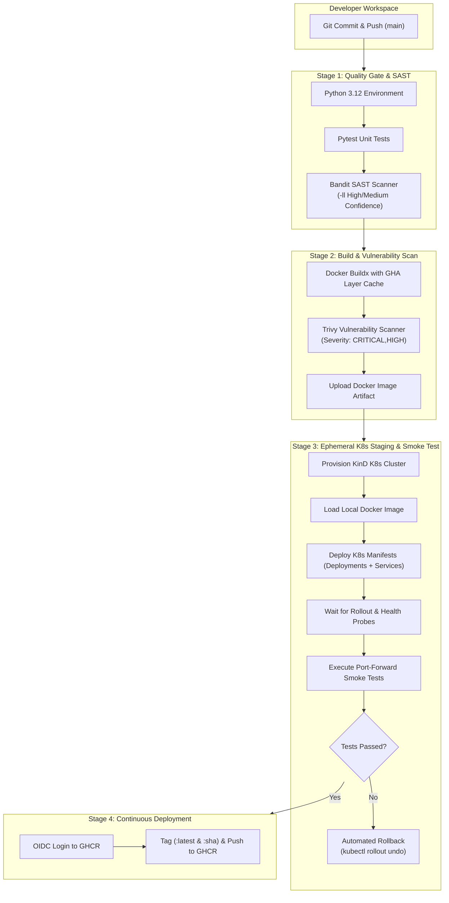

# DevSecOps CI/CD Pipeline — Project Summary & Interview Preparation Guide

This document is a comprehensive interview preparation and architectural review reference for the **CI/CD Pipeline with Security Scanning** project.

---

## 1. Executive Summary (The 30-Second Elevator Pitch)

> *"I designed and built a production-ready **DevSecOps CI/CD pipeline** demonstrating **Shift-Left Security** principles for a containerized Python microservice. The automated pipeline enforces strict quality gates, executes static application security testing (SAST) with **Bandit**, builds hardened OCI container images with **Docker Buildx**, scans container images for CVE vulnerabilities with **Trivy**, provisions an ephemeral **Kubernetes (KinD)** cluster to validate rolling updates and smoke-test endpoints with automated rollback capabilities, and securely publishes verified images to **GitHub Container Registry (GHCR)**."*

---

## 2. Architecture & Pipeline Workflow



---

## 3. Four-Stage Pipeline Deep-Dive

### Stage 1: Quality Gate & Static Application Security Testing (SAST)
* **Testing Framework**: `pytest` executes unit test suites validating route functionality, JSON contracts, and HTTP status codes (`/` and `/health`).
* **Security Scanner**: `bandit -r app -ll` performs Abstract Syntax Tree (AST) analysis on Python source files.
* **Objective**: Catches code-level security issues (hardcoded credentials, injection vulnerabilities, insecure function usage) early in the development lifecycle before any container build occurs.

### Stage 2: Container Build & Vulnerability Scanning (Trivy)
* **Build Engine**: Docker Buildx with GitHub Actions caching backend (`cache-from: type=gha`, `cache-to: type=gha,mode=max`) to optimize CI runtime and layer reuse.
* **CVE Scanner**: `aquasecurity/trivy-action` scans the container image with `exit-code: 1`, `ignore-unfixed: true`, and `severity: CRITICAL,HIGH`.
* **Objective**: Prevents vulnerable base image packages and known dependency CVEs from progressing downstream.

### Stage 3: Kubernetes Deployment & Smoke Testing (KinD)
* **Cluster Engine**: Provisions a temporary **KinD (Kubernetes in Docker)** cluster inside the GitHub Actions runner.
* **Image Sideloading**: Loads the scanned image archive directly into KinD without needing to pull from an external registry.
* **Manifests Applied**: Declarative `k8s/deployment.yaml` and `k8s/service.yaml`.
* **Verification & Smoke Testing**: Waits for rolling deployment rollout (`kubectl rollout status`), forwards ports, and runs automated HTTP health requests with curl retries.
* **Automated Rollback**: If health checks or rollouts fail, the pipeline executes `kubectl rollout undo deployment/devsecops-deployment` and dumps diagnostic logs (`kubectl describe`) before exiting with an error.

### Stage 4: Publish to GitHub Container Registry (GHCR)
* **Authentication**: Seamless authentication via `docker/login-action` using ephemeral GitHub Actions tokens (`${{ secrets.GITHUB_TOKEN }}`), avoiding long-lived static secrets.
* **Dual Tagging Strategy**:
  * `:latest` for standard environment tracking.
  * `:${{ github.sha }}` for immutable, auditable releases mapped to exact Git commits.

---

## 4. Security Hardening & Best Practices

### Container Hardening (`Dockerfile`)
1. **Minimal Base Image**: `python:3.12-slim` to eliminate unnecessary binaries and reduce attack surface.
2. **Dedicated Non-Root User**: Creates unprivileged user and group (`UID/GID 10001`, `appuser`) with `/sbin/nologin`.
3. **Execution Safety**: Enforces unbuffered output (`PYTHONUNBUFFERED=1`) and disables byte-code compilation (`PYTHONDONTWRITEBYTECODE=1`).
4. **Layer Optimization**: Copies `requirements.txt` and installs dependencies prior to copying application source code to maximize Docker cache hit rates.
5. **WSGI Server**: Production-grade `gunicorn` with `--worker-tmp-dir /tmp` and explicit access/error logging.

### Kubernetes Security Context (`k8s/deployment.yaml`)
1. **Read-Only Root Filesystem**: `readOnlyRootFilesystem: true` prevents attackers or buggy processes from modifying runtime container binaries.
2. **Ephemeral Heartbeat Storage**: Mounted `emptyDir` at `/tmp` to allow Gunicorn worker heartbeats to operate seamlessly on a read-only root filesystem.
3. **Dropped Linux Capabilities**: `capabilities: drop: ["ALL"]` strips all default Linux kernel capabilities.
4. **Privilege Escalation Blocked**: `allowPrivilegeEscalation: false` prevents child processes from gaining elevated permissions.
5. **Seccomp Profile**: Configured with `seccompProfile: { type: RuntimeDefault }` to restrict dangerous system calls.
6. **Zero-Downtime Rollouts**: `strategy: RollingUpdate` with `maxUnavailable: 0` and `maxSurge: 1`.
7. **Health Probes**: Configured `/health` for both `livenessProbe` and `readinessProbe` with tuned timeouts and failure thresholds.

---

## 5. Top 10 Technical Interview Questions & Answers

### Q1: What does "Shift-Left Security" mean and how is it demonstrated in this project?
> **Answer**: "Shift-Left means integrating security checks as early as possible in the software delivery lifecycle rather than treating security as an afterthought or post-deployment audit. In this project, Shift-Left is enforced in two ways: first, code is scanned for AST security flaws with Bandit before containerizing; second, dependencies and container layers are scanned for CVEs with Trivy before deployment to staging. Any critical finding fails the pipeline immediately."

### Q2: What is the difference between Bandit and Trivy?
> **Answer**: "They operate on distinct layers of the software stack:
> - **Bandit** is a SAST (Static Application Security Testing) tool that parses Python AST to identify code-level vulnerabilities, such as hardcoded passwords, unsafe deserialization (pickle), or shell command injections.
> - **Trivy** is a container vulnerability and SCA (Software Composition Analysis) scanner that inspects the compiled container image, base OS packages (Debian slim), and installed dependencies against known CVE databases."

### Q3: How did you solve the problem of running Gunicorn with a read-only root filesystem in Kubernetes?
> **Answer**: "In a hardened container with `readOnlyRootFilesystem: true`, processes cannot write to the local filesystem. Gunicorn workers default to creating temporary sync and heartbeat files in `/tmp`. To prevent crashes, I added a Kubernetes `emptyDir` ephemeral volume mounted at `/tmp` and configured Gunicorn with `--worker-tmp-dir /tmp`. This satisfies Gunicorn's requirement for writable temporary storage without compromising root filesystem immutability."

### Q4: Why did you use KinD (Kubernetes in Docker) inside the CI workflow instead of deploying straight to a cloud cluster?
> **Answer**: "Using KinD provides an isolated, cost-effective, and ephemeral staging environment directly inside the CI runner. It enables automated testing of actual Kubernetes manifests, rolling update behaviors, service networking, and liveness/readiness probes on every pull request without requiring expensive cloud infrastructure or risking broken deployments on shared development clusters."

### Q5: How does your pipeline prevent zero-downtime deployment failures?
> **Answer**: "Through three mechanisms:
> 1. Kubernetes RollingUpdate strategy with `maxUnavailable: 0` ensures existing healthy pods remain active while new pods spin up.
> 2. `readinessProbe` ensures traffic is only routed to newly spawned pods once they respond with HTTP 200 OK on `/health`.
> 3. CI-level automated rollback: If a rollout fails or smoke tests do not pass within 120 seconds in CI, the workflow executes `kubectl rollout undo` to verify graceful recovery before notifying engineers."

### Q6: How do you manage secrets and permissions within GitHub Actions?
> **Answer**: "We adhere to the principle of least privilege. The workflow sets top-level permissions to `permissions: contents: read`. Only the final publish stage requests elevated `permissions: packages: write`. We utilize GitHub's built-in OIDC authentication (`GITHUB_TOKEN`) for GHCR access, eliminating the need to store long-lived static tokens or passwords."

### Q7: Why do you tag Docker images with both `:latest` and `:${{ github.sha }}`?
> **Answer**: "`:latest` is a convenience tag for pointing to the most recent release. However, `:latest` is mutable and creates deployment ambiguities. Tagging with the Git commit SHA (`:${{ github.sha }}`) creates an immutable, reproducible artifact reference that can be traced back to the exact code change in version control."

### Q8: What Pod Security Standards does this application follow?
> **Answer**: "It complies with the **Kubernetes Restricted Pod Security Standard**:
> - `runAsNonRoot: true` with non-root UID 10001
> - `allowPrivilegeEscalation: false`
> - `readOnlyRootFilesystem: true`
> - `capabilities: drop: ["ALL"]`
> - `seccompProfile: RuntimeDefault`
> - Ephemeral `emptyDir` volume for temp file boundaries."

### Q9: How does Docker Buildx caching benefit CI/CD performance?
> **Answer**: "Docker Buildx with the GitHub Actions cache backend (`cache-from: type=gha`, `cache-to: type=gha,mode=max`) caches image layers across CI workflow runs. By copying `requirements.txt` before the application code in the Dockerfile, dependency installation layers are reused whenever application code changes, drastically reducing build times from minutes to seconds."

### Q10: How would you scale this architecture for a large enterprise environment?
> **Answer**: 
> 1. **DAST / Dynamic Scanning**: Add OWASP ZAP or StackHawk against the ephemeral KinD environment.
> 2. **Supply Chain Security**: Implement image signing using **Cosign/Sigstore** and generate **SBOMs (Software Bill of Materials)** via Syft.
> 3. **GitOps CD**: Connect GitHub Actions to **ArgoCD** or **Flux** for continuous declarative deployment to multi-environment Kubernetes clusters (Dev -> Stage -> Prod).
> 4. **Policy-as-Code**: Enforce admission policies via **Kyverno** or **OPA Gatekeeper** to reject pods that do not meet security context standards.

---

## 6. Resume Bullet Points (Ready to Use)

* *Architected and automated an end-to-end **DevSecOps CI/CD pipeline** using **GitHub Actions**, cutting build and validation cycle times with **Docker Buildx** layer caching.*
* *Embedded **Shift-Left Security** controls including **Bandit SAST** and **Trivy container scanning**, enforcing zero-tolerance gates on CRITICAL and HIGH severity CVEs.*
* *Engineered hardened, non-root Docker container images and **Kubernetes** manifests complying with **Restricted Pod Security Standards** (`readOnlyRootFilesystem`, dropped capabilities, seccomp).*
* *Implemented ephemeral **Kubernetes (KinD)** CI staging environments with automated smoke testing and self-healing **`kubectl rollout undo`** rollback mechanisms.*
* *Published authenticated OCI artifacts to **GitHub Container Registry (GHCR)** tagged with immutable Git commit SHAs for auditable traceability.*

---

## 7. Quick Local Verification Commands

```bash
# 1. Run unit test suite
pytest -v tests/

# 2. Run static application security testing (SAST)
bandit -r app -ll

# 3. Build Docker container image
docker build -t devsecops-demo:latest .

# 4. Run containerized microservice locally
docker run -d --name devsecops-container -p 8080:8000 devsecops-demo:latest

# 5. Verify endpoints
curl http://127.0.0.1:8080/
curl http://127.0.0.1:8080/health
```
