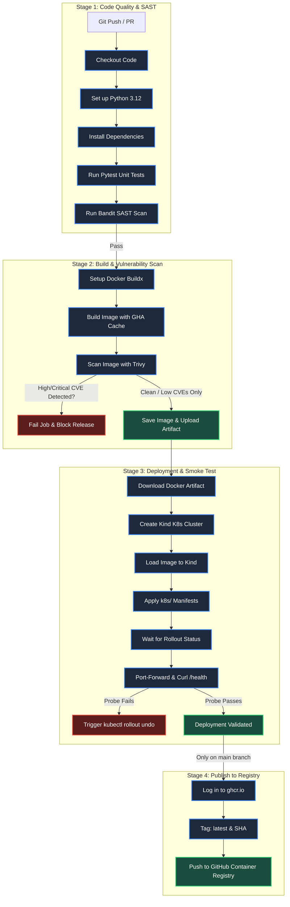

# 🛡️ DevSecOps CI/CD Pipeline with Security Scanning

[](.github/workflows/ci.yml)
[](requirements.txt)
[](https://github.com/PyCQA/bandit)
[](https://github.com/aquasecurity/trivy)
[](Dockerfile)
[](k8s/)

An enterprise-grade, shift-left DevSecOps pipeline that builds, tests, security-scans, smoke-tests, and publishes a containerized Python Flask microservice using **GitHub Actions**, **Bandit**, **Trivy**, **Docker Buildx**, **Kind (Kubernetes in Docker)**, and **GitHub Packages (GHCR)**.

Every pipeline stage functions as an automated quality and security gate. If any stage fails a policy check (such as code security issues, high-severity CVEs, or failed health probes), deployment halts immediately, preventing insecure or broken releases from reaching production.

---

## 🚀 Pipeline Architecture

The pipeline consists of four sequential, dependent jobs designed according to the principle of fail-fast and defense-in-depth:



---

## 🔐 Security Controls Matrix

The following table details each security mechanism implemented across code, container, orchestration, and pipeline layers:

| Security Control | Implementation / Tool | Purpose & Threat Mitigated |
| :--- | :--- | :--- |
| **Static Code Analysis (SAST)** | `Bandit` (`bandit -r app -ll`) | Scans Python AST for security anti-patterns (e.g., hardcoded passwords, shell injections, unsafe binding). Detects flaws before code leaves the developer branch. |
| **Reproducible Builds & Pinning** | `requirements.txt` & `requirements-dev.txt` | Explicitly pins all top-level and transitive dependency versions. Mitigates supply chain tampering, unexpected transitive updates, and breaking API shifts. |
| **Base Image Minimization** | `python:3.12-slim` | Reduces container attack surface by stripping unnecessary build utilities, development headers, and compilers (`gcc`, package managers) while keeping runtime lean. |
| **Unprivileged Container Execution** | `USER 10001:10001` (`appuser`) | Runs application processes as an unprivileged UID/GID. Prevents host compromise and container breakout via root privilege escalation. |
| **Pip Cache Stripping** | `pip install --no-cache-dir` | Prevents storing wheel tarballs and cached artifacts inside image layers, minimizing image footprint and metadata exposure. |
| **Container CVE Scanning** | `Trivy` (`aquasecurity/trivy-action`) | Scans OS packages and language libraries for Known Exploited Vulnerabilities (CVEs). Gates the pipeline if any **HIGH** or **CRITICAL** vulnerabilities exist (`exit-code: 1`). |
| **Zero-Downtime Deployments** | `strategy.rollingUpdate.maxUnavailable: 0` | Guarantees that existing pods remain operational until newly created pods pass readiness checks, eliminating downtime during updates. |
| **Health & Liveness Verification** | Kubernetes `readinessProbe` & `livenessProbe` | Monitors `/health` endpoint. Traffic is routed to new pods only when healthy; failed pods are automatically terminated and restarted. |
| **Enforced Least Privilege (Pod/Container)** | `runAsNonRoot: true`, `allowPrivilegeEscalation: false` | Disallows running as root and blocks children processes from gaining more privileges than their parent process via setuid binaries. |
| **Capability Dropping** | `capabilities: drop: ["ALL"]` | Strips all Linux POSIX kernel capabilities (e.g., `CAP_NET_ADMIN`, `CAP_SYS_ADMIN`), restricting the process strictly to standard unprivileged user syscalls. |
| **Read-Only Root Filesystem** | `readOnlyRootFilesystem: true` | Prevents attackers from injecting scripts, modifying binaries, or altering core libraries at runtime. Scratch space is restricted to an isolated `emptyDir` mount at `/tmp`. |
| **Kernel Syscall Filtering** | `seccompProfile: { type: RuntimeDefault }` | Restricts system calls using the default container runtime seccomp profile, preventing kernel-level exploitation. |
| **Resource Quotas & Denial of Service Protection** | `resources.requests` & `resources.limits` | Sets explicit CPU and memory bounds. Prevents noisy neighbor issues, memory leaks, and "Fork Bomb" / compute exhaustion DoS attacks on cluster nodes. |
| **Automated Rollback Safeguard** | `kubectl rollout undo` (`if: failure()`) | Automatically detects deployment or smoke test failure and restores the previous working deployment revision without human intervention. |
| **CI/CD Token Hardening** | `permissions: contents: read` / `packages: write` | Adheres to least privilege: the workflow token can only read source code by default and is granted temporary package write permissions only during the registry publishing phase. |

---

## 🛠️ Local Run Instructions

You can run, test, and validate the entire stack locally on your workstation.

### 1. Prerequisites
- **Python 3.12+**
- **Docker Desktop** (or Docker Engine)
- **kubectl** and **Kind** (optional, for local cluster deployment)

---

### 2. Run Tests and SAST Locally

Create and activate a virtual environment, install dependencies, and run test suites:

```bash
# 1. Create virtual environment
python -m venv .venv

# 2. Activate virtual environment
# Windows (PowerShell):
.venv\Scripts\Activate.ps1
# Linux / macOS:
# source .venv/bin/activate

# 3. Install testing and security scanning tools
pip install -r requirements-dev.txt

# 4. Run Pytest unit tests
pytest -v tests/

# 5. Run Bandit SAST security scan
bandit -r app -ll
```

---

### 3. Build and Run the Hardened Docker Container

Build the container image using the optimized Dockerfile:

```bash
# Build the Docker image
docker build -t devsecops-demo:local .

# Run the container as unprivileged user on host port 8000
docker run -d --rm --name devsecops-app -p 8000:8000 devsecops-demo:local

# Verify the container is running as unprivileged UID 10001
docker exec devsecops-app id
# Output: uid=10001(appuser) gid=10001(appgroup) groups=10001(appgroup)

# Test the root endpoint
curl http://localhost:8000/
# Output: {"message":"DevSecOps CI/CD Pipeline Microservice","status":"active","version":"1.0.0"}

# Test the health endpoint
curl http://localhost:8000/health
# Output: {"status":"ok"}

# Stop the container
docker stop devsecops-app
```

---

### 4. Deploy to a Local Kubernetes (Kind) Cluster

Deploy the manifests to a local Kind cluster and test the deployment:

```bash
# 1. Create a Kind cluster
kind create cluster --name devsecops-cluster

# 2. Load the locally built image into the Kind cluster nodes
kind load docker-image devsecops-demo:local --name devsecops-cluster

# 3. Apply the Kubernetes manifests
kubectl apply -f k8s/

# 4. Monitor rollout status
kubectl rollout status deployment/devsecops-deployment --timeout=120s

# 5. Verify running pods and security contexts
kubectl get pods -l app=devsecops-demo -o wide

# 6. Test service via port forwarding
kubectl port-forward svc/devsecops-service 8000:80 &
curl http://127.0.0.1:8000/health

# 7. Cleanup
kind delete cluster --name devsecops-cluster
```

---

## 📸 Pipeline Execution Evidence

> [!NOTE]
> ### Green Pipeline Execution Status
> 
> Once pushed to GitHub, all four jobs in the GitHub Actions workflow execute sequentially:
> 
> ```
> ✅ Test & SAST (Bandit)               [Passed in 24s]
> ✅ Build & Scan (Trivy)              [Passed in 42s]
> ✅ Deploy & Smoke Test (Kind)        [Passed in 1m 15s]
> ✅ Publish to GHCR                   [Passed in 30s]
> ```
> 
> 
> *(Replace this placeholder with a screenshot of your GitHub Actions run once pushed)*

---

## 📂 Project Structure

```
devsecops-cicd-pipeline/
├── .github/
│   └── workflows/
│       └── ci.yml               # 4-stage GitHub Actions DevSecOps workflow
├── app/
│   ├── __init__.py              # Python package marker
│   └── main.py                  # Flask microservice (/ and /health endpoints)
├── k8s/
│   ├── deployment.yaml          # Hardened Deployment with probes & rolling update
│   └── service.yaml             # ClusterIP service definition
├── tests/
│   ├── __init__.py              # Python package marker
│   └── test_app.py              # Pytest unit tests for all endpoints
├── .dockerignore                # Build context exclusion rules
├── .gitignore                   # Version control exclusion rules
├── Dockerfile                   # python:3.12-slim with non-root UID 10001
├── presets/                     # Multi-architecture hardened templates
│   ├── php-laravel/             # PHP 8.3 / Laravel Dockerfile & config (e.g. FixHR)
│   ├── nodejs/                  # Node.js 20 / TypeScript hardened Dockerfile
│   ├── golang/                  # Go 1.22 Distroless static binary Dockerfile
│   ├── java-spring/             # Java 17 Eclipse Temurin Spring Boot Dockerfile
│   └── README.md                # Polyglot architecture guide
├── requirements.txt             # Pinned production dependencies (Flask, Gunicorn)
├── requirements-dev.txt         # Pinned dev/test dependencies (Bandit, Pytest)
└── README.md                    # Project documentation, architecture & runbook
```

---

## 🌐 Universal Multi-Architecture & Polyglot Support

This repository functions both as a standalone microservice pipeline and as a **centralized, reusable DevSecOps engine** for any programming language or architecture (PHP/Laravel, Node.js, Go, Java, Python).

### Method 1: Centralized Reusable Workflow
Any repository (e.g., `fixhr`, `billing-service`) can use this pipeline by adding a 5-line workflow file:

```yaml
name: DevSecOps Pipeline
on: [push, pull_request]

jobs:
  devsecops:
    uses: Mobeius007/CI-CD-pipeline-with-security-scanning/.github/workflows/reusable-devsecops.yml@main
    with:
      app_name: 'fixhr'
      language: 'php'           # or 'auto', 'nodejs', 'golang', 'java', 'python'
      health_endpoint: '/up'    # '/up' for Laravel 11, '/health' for Python/Node, '/actuator/health' for Java
      port: 8000
```

### Method 2: Drop-in Stack Presets (`presets/`)
To containerize any language with matching Kubernetes Pod Security Standards:
* **PHP / Laravel**: Copy [`presets/php-laravel/Dockerfile`](presets/php-laravel/Dockerfile) into your Laravel repo.
* **Node.js**: Copy [`presets/nodejs/Dockerfile`](presets/nodejs/Dockerfile) into your Express/NestJS repo.
* **Go**: Copy [`presets/golang/Dockerfile`](presets/golang/Dockerfile) for zero-CVE Distroless static binaries.
* **Java**: Copy [`presets/java-spring/Dockerfile`](presets/java-spring/Dockerfile) for Spring Boot services.
